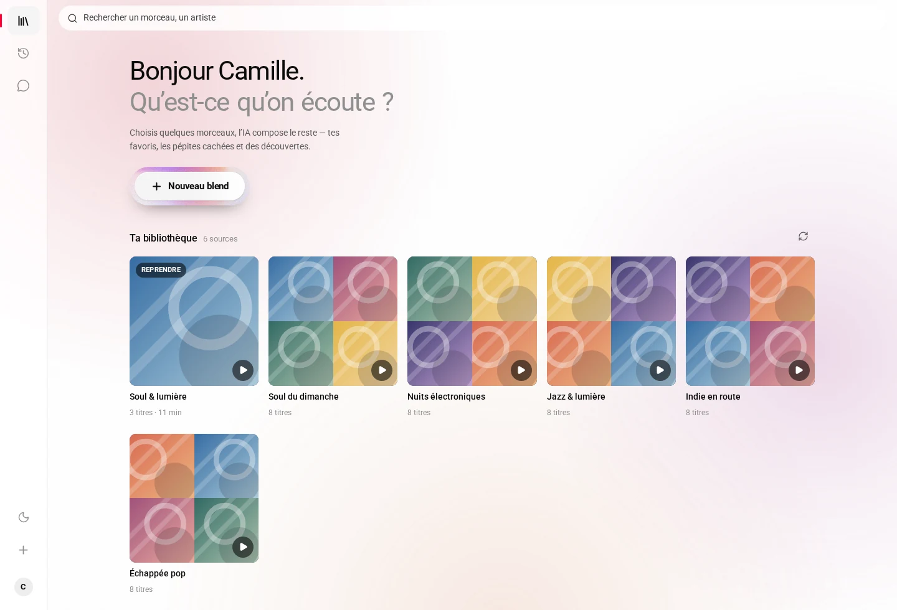
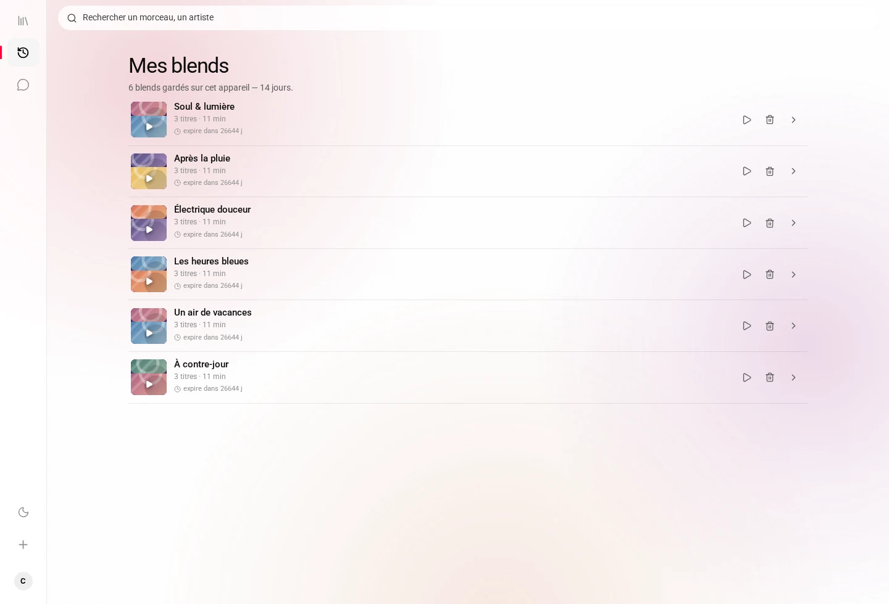
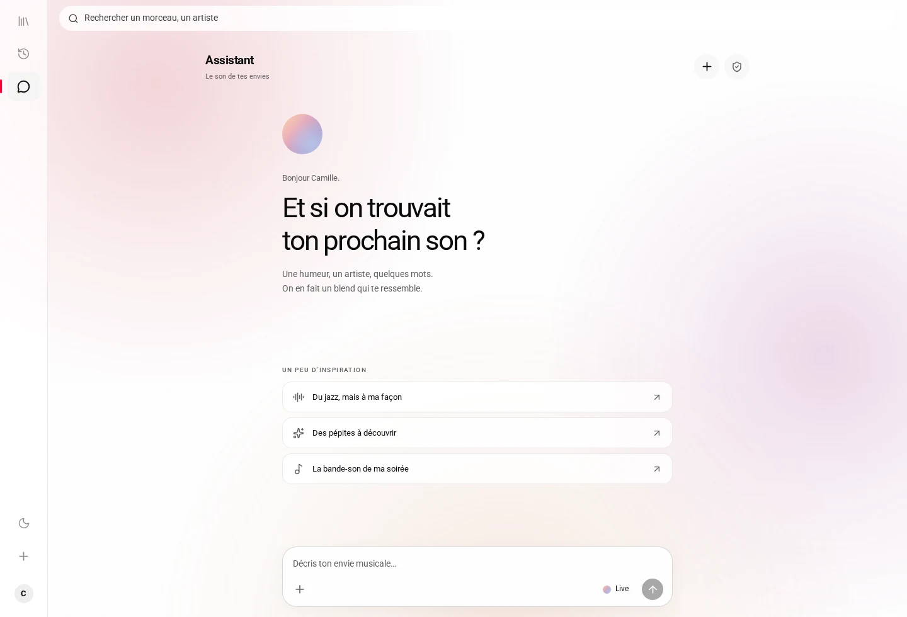
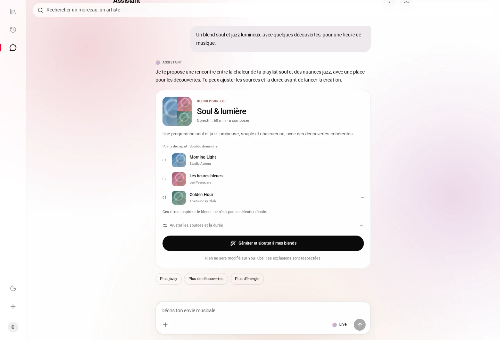
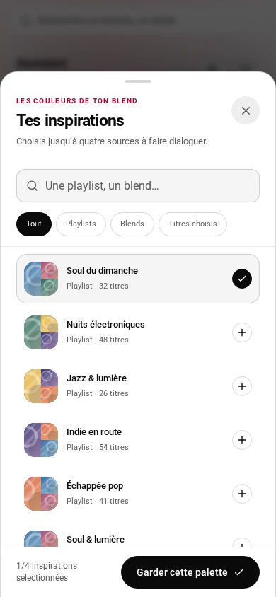
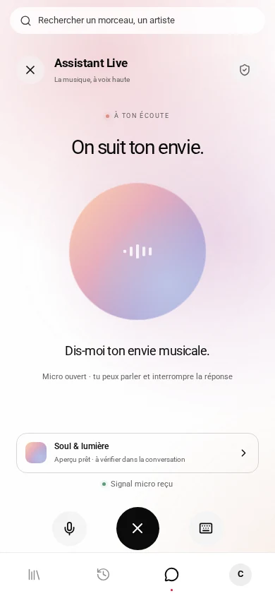
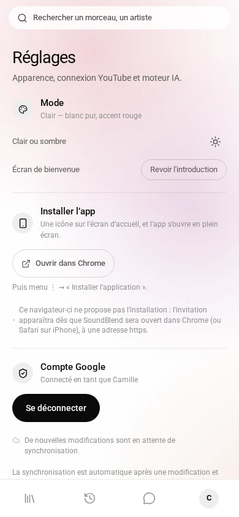

# SoundBlend

**Tes morceaux. Tes envies. Un nouveau mélange.**

SoundBlend est une application web musicale pour retrouver ses playlists YouTube, composer des **blends personnalisés** et discuter avec un assistant Gemini, à l’écrit ou à la voix. Son interface s’adapte au mobile et à l’ordinateur, avec une application installable et des thèmes clair et sombre.

> Les captures ci-dessous montrent l’interface réelle avec des données de démonstration : compte, morceaux, pochettes abstraites et réponse de l’assistant fictifs. Elles ne contiennent aucune donnée personnelle et ne constituent pas un test des services Google réels. Ces exemples ne sont pas ajoutés à ton compte par l’installation.

## Découvrir l’app

### 1. Ta bibliothèque, au même endroit

Retrouve les playlists de ton compte connecté, reprends un blend ou démarre une nouvelle sélection. La recherche permet de choisir des morceaux et des artistes comme points de départ.



### 2. Tes blends à retrouver

Un blend rassemble tes points de départ et des suggestions musicales. Retrouve tes créations récentes, ouvre leur sélection, écoute ou ajuste les titres et exporte vers une playlist YouTube. Les blends restent disponibles pendant leur durée de validité de 14 jours.



### 3. Un assistant pour tes envies musicales

Décris ce que tu veux écouter, ajoute des références précises et affine la proposition dans la conversation. Le bouton **+ en haut à droite** donne accès aux trois dernières discussions, liées au compte et synchronisées dans son espace privé Drive lorsque l’autorisation est active.



### 4. Une proposition avant de créer

L’assistant prépare un aperçu avec les sources, la consigne et la durée souhaitée. Tu peux les modifier avant de lancer la génération. Les modifications de playlists passent également par une prévisualisation et une confirmation explicite : une discussion seule ne modifie pas ta bibliothèque YouTube.



### 5. Choisis tes inspirations

Associe jusqu’à quatre sources, filtre les playlists et les blends, puis ajuste la durée. La recherche du sélecteur ne prend pas automatiquement le focus : sur mobile, tu choisis quand ouvrir le clavier.



### 6. Parle avec l’assistant Live

Le Live permet un échange vocal avec Gemini. Le micro peut être coupé à tout moment et **Terminer** ferme les dispositifs audio. Le curseur agit uniquement sur la voix IA :

| Volume affiché | Gain appliqué à la voix IA |
|---|---:|
| 0 % | Silence |
| **50 % — valeur initiale** | **5 % du gain unitaire** |
| 100 % | 10 % du gain unitaire |

Cette échelle volontairement douce ne change ni la musique ni la capture du micro. Le choix est mémorisé sur l’appareil ; **Réinitialiser à 50 %** rétablit la valeur initiale. Le gain mesure l’amplitude du signal, pas la sonie perçue. Les boutons matériels du téléphone peuvent rester sans effet selon le navigateur et son routage audio.



### 7. Garde le contrôle

L’avatar ouvre les réglages : compte Google, accès Gemini, apparence, synchronisation et exclusions. Tu peux exclure un morceau ou un artiste séparément et revenir sur ces choix.



## Lancer le projet

Prérequis : **Node.js 22.12 ou plus récent** et npm.

Dans le dossier contenant `package.json` :

```sh
npm ci
npm run dev
```

Ouvre **http://localhost:5173** — ou le port indiqué par Vite si celui-ci est occupé.

Pour compiler et vérifier le site :

```sh
npm run lint
npm run build
npm run preview
```

Le site compilé est créé dans `dist/` ; la prévisualisation utilise **http://localhost:4173**. Le ZIP contient les sources, pas les dépendances ni une compilation préfabriquée.

### Configuration essentielle

- **Google / YouTube** : le client OAuth public se configure dans `src/config/app.ts`. Autorise l’origine du site et son URI de redirection exacte dans Google Cloud. Aucun secret client ne doit être ajouté au navigateur.
- **Gemini** : saisis ta clé personnelle dans **Réglages**. L’assistant et le Live dépendent des accès aux modèles, des quotas et d’une éventuelle facturation Google.
- **Microphone** : HTTPS ou localhost, autorisation micro et navigateur compatible requis. Une installation sur téléphone ne garantit pas la prise en charge du Live sur tous les appareils.
- **Sous-dossier** : si nécessaire, compile avec `BASE_PATH=/nom-du-depot/ npm run build`. Le workflow GitHub Pages existant est conservé dans `.github/workflows/` ; aucun guide de déploiement séparé n’est joint.

## Données et limites à connaître

- L’app fonctionne **sans serveur applicatif ajouté**. Les requêtes Gemini partent du navigateur. Le contexte musical et les échanges nécessaires à la réponse, ainsi que l’audio pendant le Live, sont envoyés à Google. Certaines recherches utilisent aussi des instances Piped indépendantes ; les pochettes peuvent provenir de services externes.
- Les données locales sont séparées par compte. Après autorisation, des réglages, blends, exclusions et discussions peuvent être synchronisés dans l’espace privé `appDataFolder` de Google Drive. La clé Gemini est accessible en clair au navigateur et peut être synchronisée avec les réglages : protège ton appareil et ton compte.
- Une préparation peut continuer pendant la navigation interne tant que la page reste active. **Aucun calcul n’est garanti après fermeture, suspension ou arrêt du navigateur.** Une tâche interrompue peut nécessiter une relance explicite.
- La PWA peut conserver son interface après un premier chargement complet en ligne ; YouTube, Gemini, Drive et les recherches nécessitent le réseau. La musique n’est pas téléchargée pour l’écoute hors ligne.
- Les exports et modifications YouTube ne sont pas atomiques. Après une interruption, vérifie la playlist existante avant de relancer une création.
- Le lecteur YouTube hérité utilise une sortie masquée et peut ajouter un second lecteur de clip : **l’intégration doit être revue avant une diffusion conforme aux règles YouTube**. Vérifie également les conditions Gemini applicables à ton usage, notamment dans l’EEE. Cette archive n’apporte pas de garantie de conformité ou de disponibilité des services tiers.

## Dans ce dossier

```text
SoundBlend/
├── src/                 Application React et TypeScript
├── public/              Icônes, manifeste PWA et service worker
├── docs/images/         Les 7 captures de ce README
├── .github/workflows/   Workflow GitHub Pages existant
├── package.json         Commandes et dépendances
├── package-lock.json    Versions verrouillées
├── index.html           Point d’entrée
├── README.md            Ce guide
└── …                    Configuration Vite, TypeScript, CSS et lint
```

Les rapports de versions, patchs, tests de vérification, journaux, sauvegardes, tutoriels de déploiement, `.git/`, `node_modules/` et `dist/` ne font pas partie du ZIP. Le code applicatif correspond à la dernière version de travail, avec les corrections Assistant et l’échelle de volume Live V12.1.
